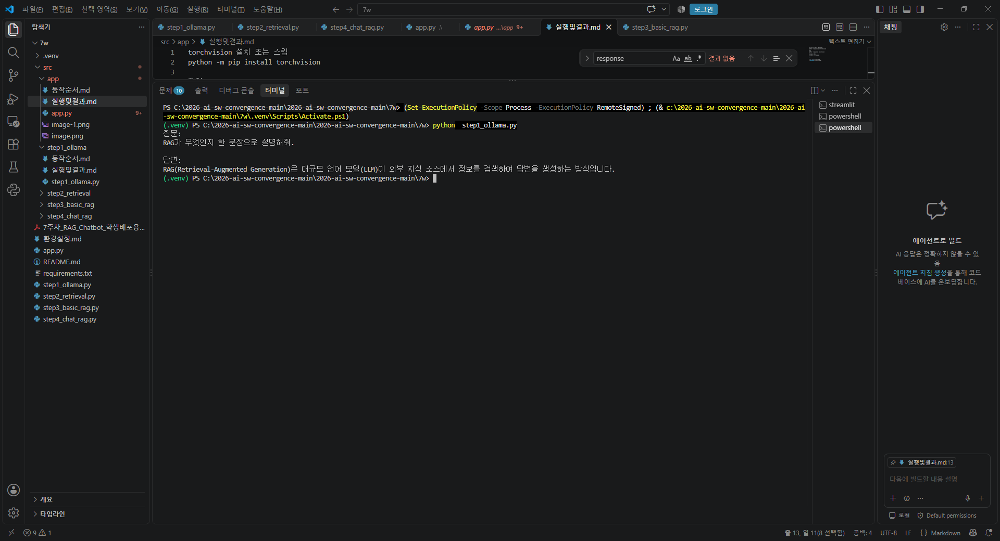

VS Code 터미널에서:

```
cdC:\2026-open\7w
.\.venv\Scripts\Activate.ps1
```

가상환경이 활성화되면:

`(.venv) PS C:\2026-open\7w>`

이 상태에서 실행합니다.

```
python  step1_ollama.py
```

정상 실행 결과는 대략:

`질문:
RAG가 무엇인지 한 문장으로 설명해줘.

답변:
RAG는 외부 문서를 검색해 관련 정보를 참고한 뒤 답변을 생성하는 방식입니다.`


