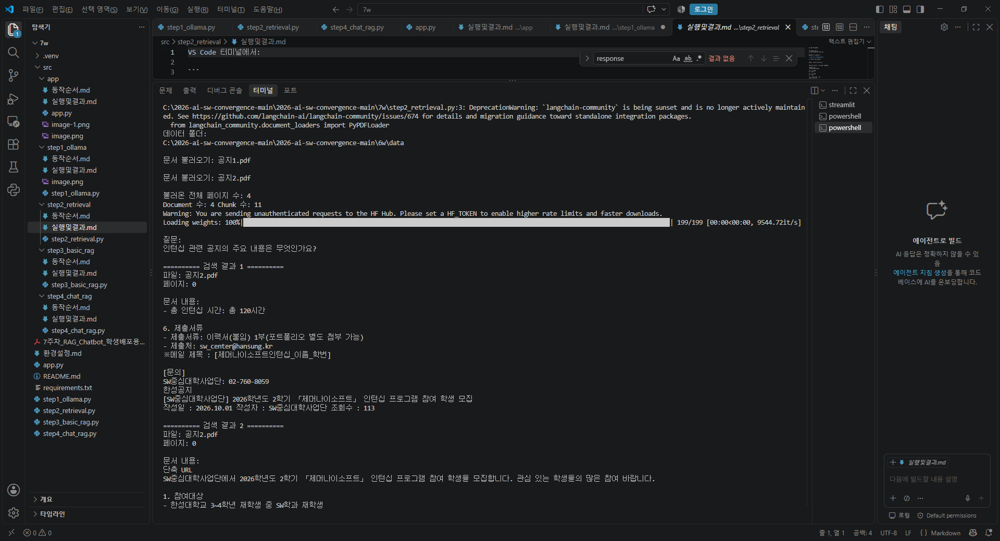

VS Code 터미널에서:

```
cdC:\2026-open\7w
.\.venv\Scripts\Activate.ps1
```

가상환경이 활성화되면:

`(.venv) PS C:\2026-open\7w>`

이 상태에서 실행합니다.

```
python  step2_retrieval.py
```

정상 실행 결과는 대략 이렇게 나옵니다.

`데이터 폴더:
C:\2026-open\6w\data

문서 불러오기:
공지1.pdf

문서 불러오기:
공지2.pdf

불러온 전체 페이지 수: ...
생성된 Chunk 수: ...

질문:
인턴십 관련 공지의 주요 내용은 무엇인가요?

========== 검색 결과 1 ==========
파일: 공지1.pdf
페이지: ...
문서 내용:
...

========== 검색 결과 2 ==========
파일: 공지2.pdf
페이지: ...
문서 내용:
...`

정리하면,

`STEP 1: Ollama 연결 확인
STEP 2: 관련 문서 검색
STEP 3: 검색 문서 기반 답변 생성
STEP 4: 이전 질문까지 반영한 대화형 RAG
STEP 5: Streamlit Chat UI`




