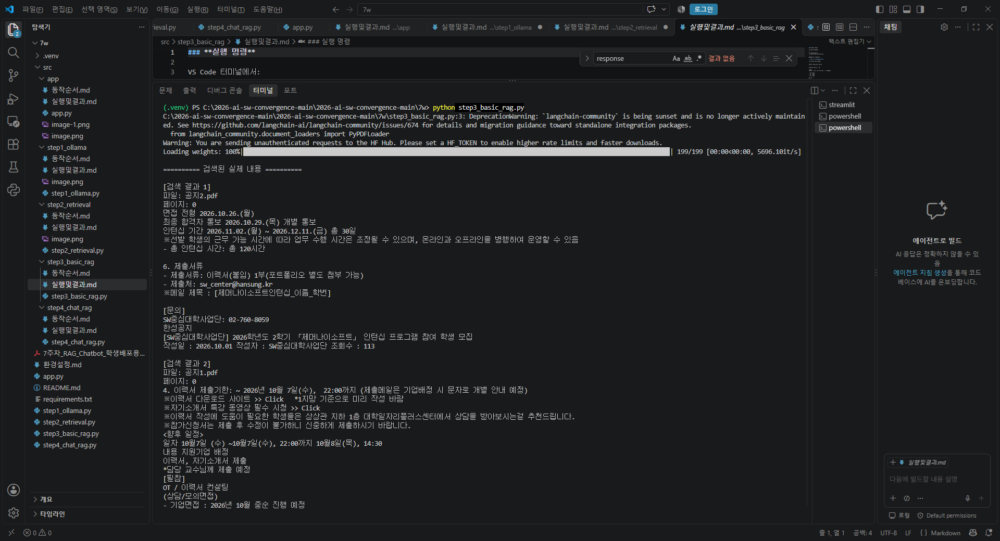
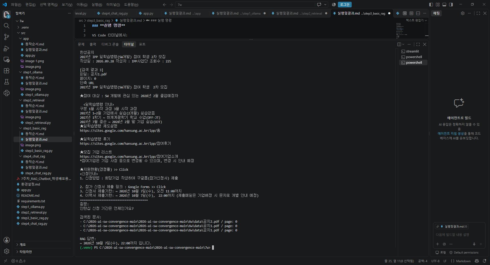

### **실행 명령**

VS Code 터미널에서:

```
cdC:\2026-open\7w
.\.venv\Scripts\Activate.ps1
```

가상환경이 활성화되면:

`(.venv) PS C:\2026-open\7w>`

이 상태에서 실행합니다.

```
python step3_basic_rag.py
```

정상 실행 결과는 대략:

`질문:
인턴십 관련 공지의 주요 내용은 무엇인가요?

검색된 문서:
- 공지1.pdf
- 공지2.pdf
- 공지1.pdf

RAG 답변:
...`

즉 STEP 2가 **관련 문서 검색까지**, STEP 3이 **검색된 문서를 이용한 답변 생성까지**입니다.






