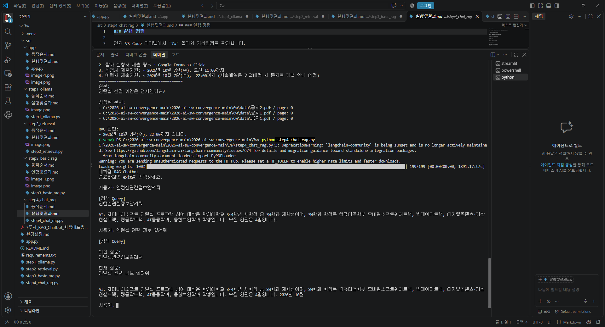

### 실행 명령

먼저 VS Code 터미널에서 `7w` 폴더와 가상환경을 확인합니다.

```
cd C:\2026-open\7w
.\.venv\Scripts\Activate.ps1
```

터미널 앞에 다음처럼 보이면 정상입니다.

```
(.venv) PS C:\2026-open\7w>
```

그다음 실행:

```
python step4_chat_rag.py
```

정상 실행되면:

```
대화형 RAG Chatbot
종료하려면 exit를 입력하세요.

사용자:
```

처럼 나옵니다.

예를 들어:

```
사용자: 인턴십 관련 정보 알려줘.
AI: ...

사용자: 그럼 제출 기한은?
AI: ...
```

처럼 **두 번째 질문에서 이전 질문의 맥락을 이어받는 것**이 STEP 4의 핵심입니다.

종료할 때는:

```
exit
```

를 입력하면 됩니다.

---



